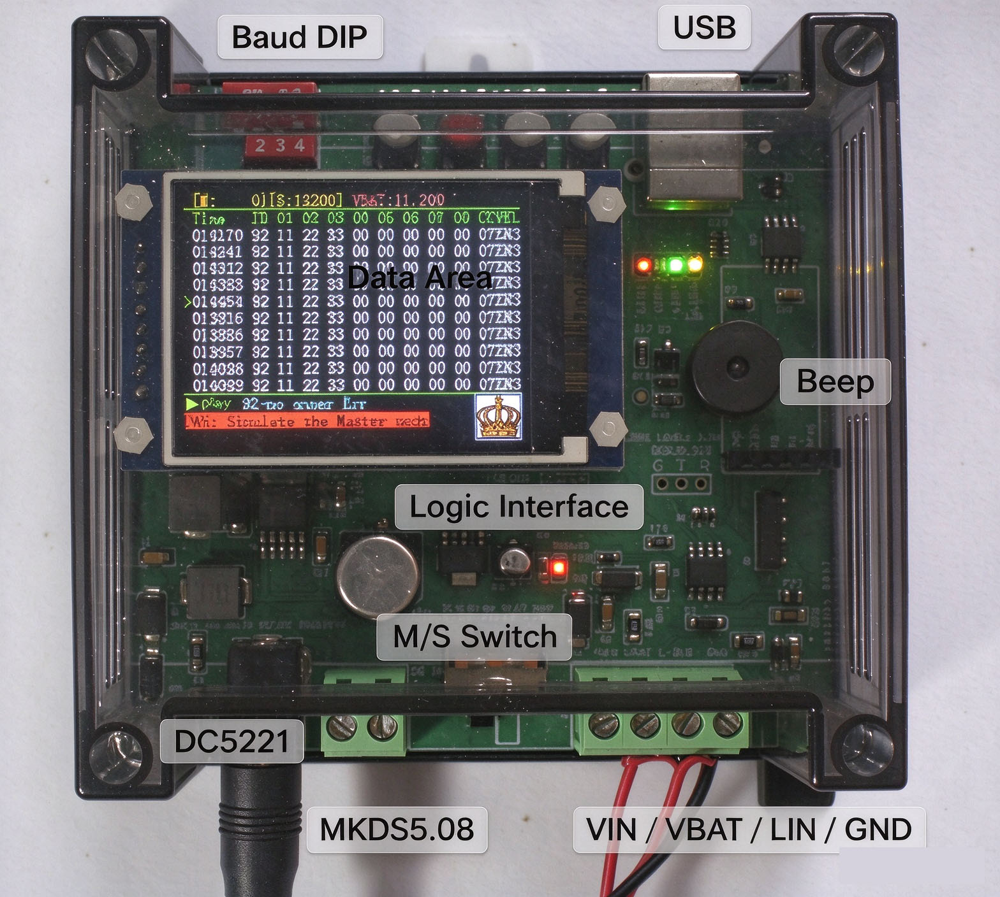
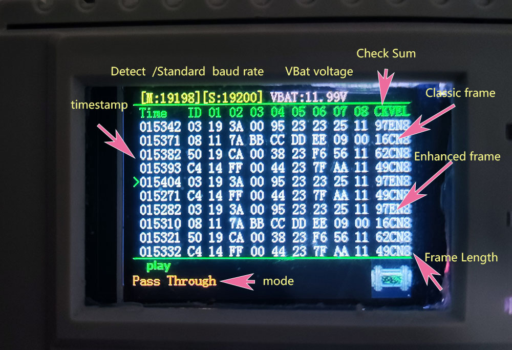
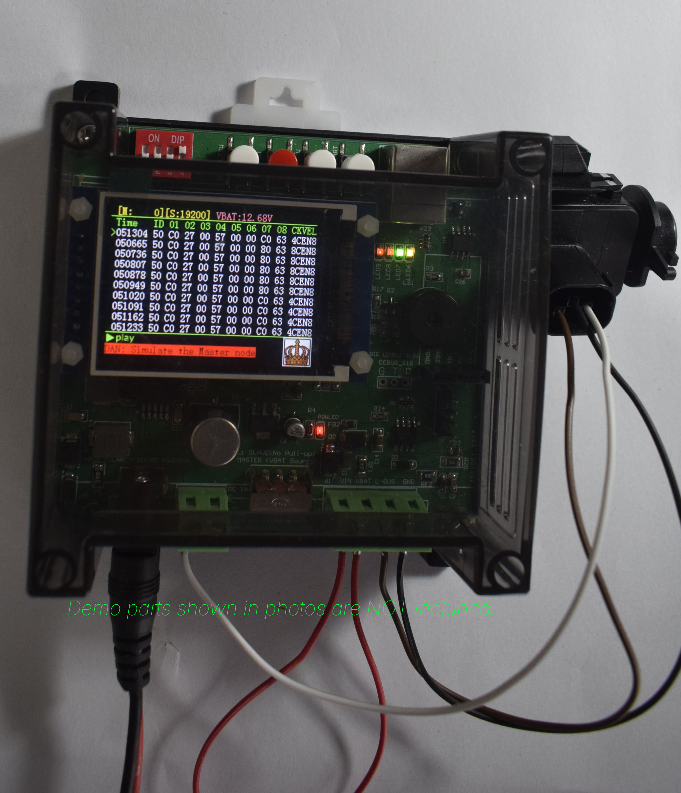

# LINOTTER — Standalone LIN Bus Protocol Analyzer & Node Simulator
Standalone LIN Bus Protocol Analyzer &amp; Master/Slave Simulator with 10-line LCD, Payload Deduplication, ID Filter, and Auto-Baud (4800-19200 bps).

Designed and assembled in small batches by **LINOTTER – Ethan**.

**LINOTTER** is an assembled, standalone benchtop instrument designed for LIN bus communication analysis, development, controlled bench testing, and hands-on protocol learning. Basic monitoring requires no PC—just apply 7.4–12V DC power and observe live LIN traffic directly on the built-in 10-line LCD.

**[Watch Video Demo on YouTube](https://youtu.be/c43uP8N8cfs)**

https://youtu.be/c43uP8N8cfs

---

## Key Features (Why I Built This)

When testing automotive or industrial LIN nodes on a bench, setting up a PC interface and scrolling through thousands of identical repeating frames is tedious. LINOTTER solves this directly in hardware:

* **Standalone 10-Line LCD Display:** Directly displays timestamps, frame identifiers (ID), data bytes, payload length, checksum type (Classic or Enhanced), frame error status, and live `VBAT` bus-supply voltage without a computer.
* **Payload Deduplication Mode:** Suppresses identical repeated payloads on screen and refreshes only when the data bytes actually change—making it effortless to spot state changes during reverse engineering or bench testing.
* **ID Filter Mode:** Isolates and displays traffic for one selected frame ID while hiding unrelated bus traffic.
* **Auto-Baud & Manual DIP Selection:** Supports standard LIN baud rates (`19200`, `10417`, `9600`, and `4800` bps). Features automatic baud-rate detection in Listen, Deduplication, and ID Filter modes, plus physical DIP switches for manual override.
* **Master & Slave Simulation:** Can actively transmit LIN Master Request Frames or simulate a LIN Slave node responding to a specific ID with a user-defined payload.
* **Hardware Pull-Up Switch:** Onboard physical switch (`L: SLAVE No Pull-up` / `R: MASTER VBAT Source`) to configure bus termination independently on the bench.
* **Visual & Audible Error Alerts:** Built-in buzzer and screen highlights alert you immediately to timeouts, invalid checksums, or no-response frames.
* **Simple Serial Terminal Configuration:** Uses a rugged USB Type-B port (115200 bps serial) compatible with PuTTY or any standard serial terminal for configuring ID filters and simulation payloads—no proprietary, bloated PC software required.

---

## Hardware & Technical Specifications

| Parameter | Specification |
| :--- | :--- |
| **Bus Type** | LIN single-wire bus |
| **Operating Modes** | Listen / Deduplication / ID Filter / Slave Simulation / Master Simulation |
| **Supported LIN Baud Rates** | 19200 / 10417 / 9600 / 4800 bps (Auto-baud in passive/filter modes; DIP switch in all modes) |
| **Display** | 10-line data LCD + status/message areas + live VBAT voltage readout |
| **Error Detection** | Timeout, invalid checksum, and no-response alerts (LCD + Audible Buzzer) |
| **USB Interface** | USB Type-B serial (115200 bps) for configuration & real-time monitoring (No USB power) |
| **Main Power Input** | 7.4–12 V DC recommended (16 V DC absolute max) via 5.5×2.1 mm DC jack or 2-pin terminal |
| **Bench Terminals** | 4-pin terminal (`VIN` shared supply, `VBAT`, `L-BUS`, `GND`) with reverse-polarity protection on main inputs |

---

want to reach me? just leave a message in issue. or you can got it  https://www.ebay.com.au/itm/318932141106 very reasonable prices.
